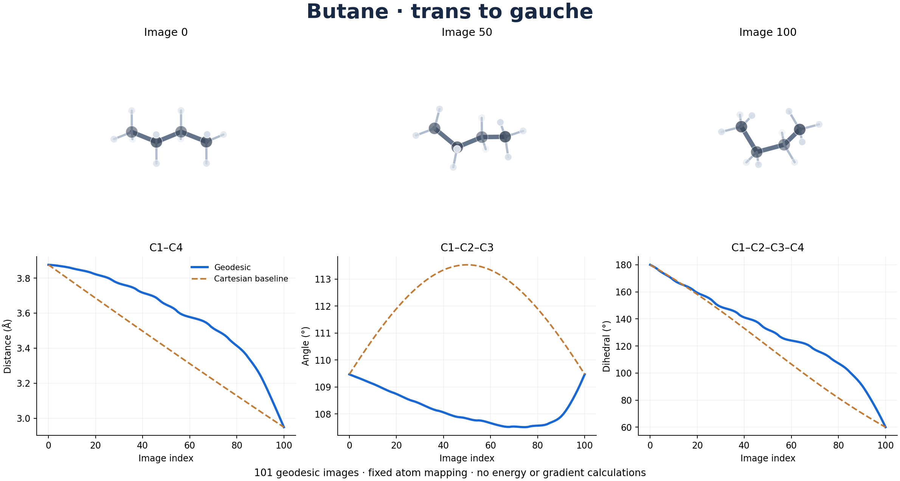

# Butane path explorer

This geometry-only example follows idealized trans butane to a gauche conformer.
There are 14 explicitly mapped atoms and 101 geodesic images. It runs no SCF,
DFT, electronic energy or electronic gradient calculations.

## Open the results

Download [`results/butane/report.html`](results/butane/report.html) and open it in
a WebGL-capable browser. GitHub displays HTML source rather than running the
viewer. The file embeds the data, 3Dmol.js 2.5.5 and its license notices, and
requires no CDN or local server.

- Rotate and zoom the ball-and-stick molecule; reset the camera when needed.
- Play/pause the sequence or move its image slider.
- Click a plot to move both the molecule and all graph markers to that image.
- Choose a bond length, angle or dihedral from the measurement menus.
- Enter any valid two, three or four atom indices, or use **Pick atoms** and
  select them in order in the molecule. Custom measurements join the plots
  and CSV export. Hydrogen labels appear when those atoms are selected.
- Switch the molecule between geodesic and Cartesian paths. The optional
  dashed graph traces show the Cartesian baseline.
- Export the path, current frame or measurement CSV. A copyable export-text
  fallback is provided when a browser restricts file downloads.



[Vector figure](results/butane/geometry_summary.svg) ·
[Geodesic XYZ](results/butane/path.xyz) ·
[Cartesian XYZ](results/butane/cartesian.xyz) ·
[All measurements](results/butane/measurements.csv) ·
[Run settings](results/butane/run.json)

## Reproduce

Use this fork with the optional dependencies in `requirements.txt`. The recorded
101-image run used the selected backend repository at commit
`476aa041f562d37d5fb4121b86817a52d75e4c5d`, which has a sparse joint solver:

```sh
python -m pip install 'geodesic-interpolate @ git+https://github.com/virtualzx-nad/geodesic-interpolate.git@476aa041f562d37d5fb4121b86817a52d75e4c5d'
OMP_NUM_THREADS=1 OPENBLAS_NUM_THREADS=1 python dilawar7/geodesic/examples/03_butane_path.py
```

The published backend 1.0.0 has the same import name but uses a dense solver;
runtime and memory use can differ substantially for many images. `run.json`
records the backend commit and whether the sparse solver was available.

Options include `--nimages`, `--seed`, `--maxiter`, `--output` and `--data-only`.
The default seed is 7. Rebuild only the HTML, without rerunning interpolation:

```sh
python dilawar7/geodesic/examples/path_report.py dilawar7/geodesic/results/butane/analysis.json
```

## Measurements and conventions

The fixed graph has 13 covalent bonds. We enumerate its 24 bond angles and 27
proper dihedrals, and add the C1-C4 contact distance: 65 coordinate traces in all.
Distances use Angstrom; angles and dihedrals use degrees. Atom labels, CSV column
names and viewer selections use **1-based** numbering. The Python analysis API
uses **0-based** indices, consistent with PySCF.

CSV contains geodesic and Cartesian traces, both wrapped and unwrapped torsions,
and an equal-atom-weight RMSD after proper rigid alignment. The interactive
CSV also includes newly selected custom coordinates; its static download has
185 columns including image index. The on-disk CSV additionally has an RMSD
column (186 columns).

Torsions use the signed i-j-k-l convention documented in
[`path_analysis.py`](../../pyscf/geomopt/path_analysis.py). Exact trans is +180
degrees. Torsions are unwrapped within continuous finite segments, assuming
neighboring changes below 180 degrees. Degenerate angles/dihedrals are NaN in
Python, null in JSON and empty fields in CSV; plot lines break across gaps.

```python
from pyscf.geomopt import path_analysis

# xyz has shape (number_of_images, number_of_atoms, 3), in Angstrom.
lengths = path_analysis.distances(xyz, [(0, 3)])
angles = path_analysis.angles(xyz, [(0, 1, 2)])
torsions = path_analysis.dihedrals(xyz, [(0, 1, 2, 3)])
continuous = path_analysis.unwrap_dihedrals(torsions)
```

## Scientific scope

Endpoint coordinates are generated analytically: C-C 1.54 Angstrom, C-H 1.09
Angstrom and tetrahedral angles arccos(-1/3). The central torsion changes from
180 to +60 degrees by rotating the complete right-hand fragment. They are
idealized model structures, not experimental structures or optimized minima.

Every requested image is included in the backend's path optimization; no extra
display frames are inserted. The backend may stop before convergence, which
this adapter does not certify. Image index is neither time nor a uniform
reaction coordinate. The baseline is a Cartesian line between the same aligned
endpoint frames. Graph differences describe geometry, not energetic quality.

The displayed connectivity is supplied explicitly and held fixed. Bond orders
or chemical reactions are not inferred from interatomic distances.
