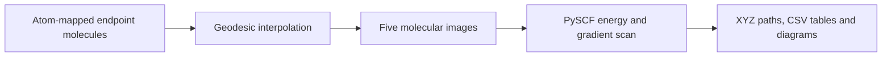
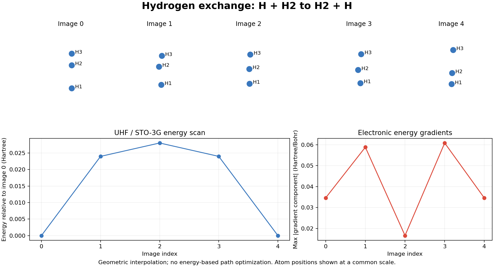
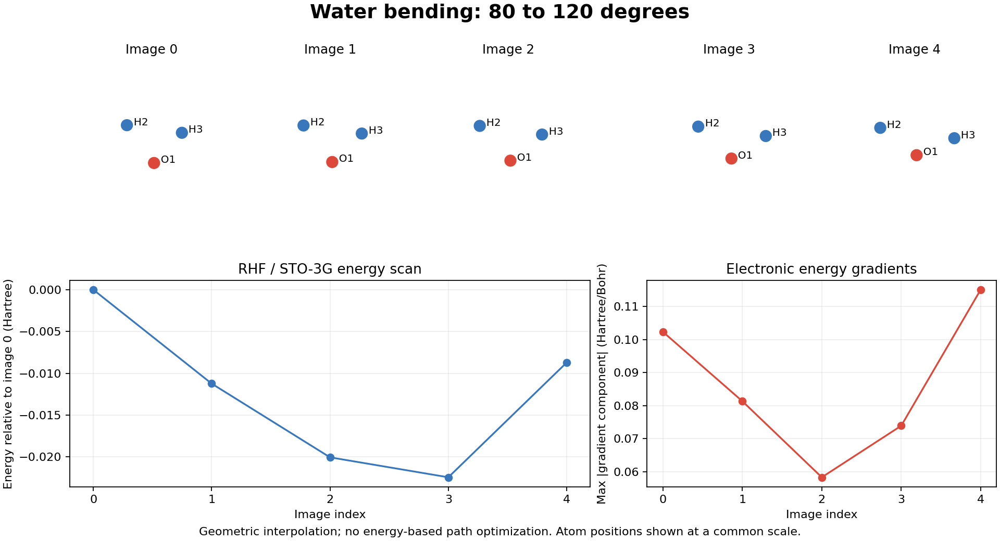

# Dilawar's geodesic interpolation examples

This optional adapter connects [geodesic-interpolate](https://github.com/virtualzx-nad/geodesic-interpolate)
to PySCF molecular objects. It generates a geometric path between atom-mapped
endpoints. PySCF can then evaluate an energy and gradient at each image.
Our work is on branch `dilawar7/geodesic-interpolation`.

**Start here:** [Butane path explorer](BUTANE.md) — 101 geometries, a rotatable
3D molecule, synchronized distance/angle/dihedral graphs, atom picking and
coordinate exports. This example makes no electronic energy or gradient calls.

Download and open [the standalone HTML report](results/butane/report.html) in
your browser; GitHub itself shows HTML source.



## Folder layout

- `examples/`: runnable examples and shared output/plotting code.
- `results/hydrogen_exchange/`: saved H + H2 exchange path and UHF/STO-3G scan.
- `results/water_bending/`: saved water bending path and RHF/STO-3G scan.
- `results/butane/`: geometry-only 101-image path, measurements and HTML report.
- `report/`: editable viewer/report source and pinned third-party bundle.
- `tests/`: independent checks of the exported geometries and energies.
- The importable adapter stays at [`pyscf/geomopt/geodesic.py`](../../pyscf/geomopt/geodesic.py).
- Adapter tests stay at [`pyscf/geomopt/test/test_geodesic.py`](../../pyscf/geomopt/test/test_geodesic.py).

## Run the examples

Install this branch with the optional dependency using the normal PySCF source
installation procedure:

```sh
python -m pip install -e '.[geodesic]'
python -m pip install -r dilawar7/geodesic/requirements.txt
OMP_NUM_THREADS=1 OPENBLAS_NUM_THREADS=1 python dilawar7/geodesic/examples/01_hydrogen_exchange.py
OMP_NUM_THREADS=1 OPENBLAS_NUM_THREADS=1 python dilawar7/geodesic/examples/02_water_bending.py
```

A source installation requires PySCF's native build dependencies. Installing the
standard PySCF release alone does not provide this prototype module.

Run commands from the repository root. Both examples use NumPy seed 7 by
default and accept `--seed` and `--output` options. Each writes `path.xyz`
(Angstrom), `energies.csv` (Hartree and Hartree/Bohr), `run.json` (settings and
package versions), and vector SVG plus PNG diagrams. Rerunning an example
replaces its output files. The diagrams show atom positions at a common scale;
they do not assign chemical bonds. Cross-platform floating-point results and
randomly generated paths can differ.

## Worked example 1: hydrogen exchange

The endpoints exchange a free H atom with an H2 molecule. Atom ordering is
explicit and unchanged: the first adjacent separation goes from 1.50 to
0.74 Angstrom and the second goes from 0.74 to 1.50 Angstrom. Spin is 1
(a doublet), with UHF/STO-3G energies and gradients along five images.



[Coordinates](results/hydrogen_exchange/path.xyz) ·
[Energy table](results/hydrogen_exchange/energies.csv) ·
[Vector diagram](results/hydrogen_exchange/path_and_energy.svg)

## Worked example 2: water bending

The H-O-H angle changes from 80 to 120 degrees. Both endpoint O-H lengths
are 0.95 Angstrom. Spin is 0, with RHF/STO-3G energies and gradients.
Interior bond lengths are free to change under the interpolation metric.
This is a deformation example, not a reaction or an optimized bending scan.



[Coordinates](results/water_bending/path.xyz) ·
[Energy table](results/water_bending/energies.csv) ·
[Vector diagram](results/water_bending/path_and_energy.svg)

## Adapter API

```python
from pyscf import gto
from pyscf.geomopt.geodesic import interpolate

reactant = gto.M(atom='H 0 0 -1.5; H 0 0 0; H 0 0 .74',
                 basis='sto-3g', spin=1, verbose=0)
product = reactant.copy().set_geom_(
    'H 0 0 -.74; H 0 0 0; H 0 0 1.5')
images = interpolate(reactant, product, nimages=5)
scanner = reactant.UHF().nuc_grad_method().as_scanner()
energy, gradient = scanner(images[2])  # Hartree; Hartree/Bohr
```

Both endpoints must have matching atom labels, atom order, charge and spin.
The caller must establish atom correspondence, including correspondence between
identical elements. The adapter converts coordinates to Angstrom for the
backend. Returned molecules inherit the first endpoint's basis and molecular
settings, use Angstrom, and disable point-group symmetry. Inputs are unchanged.
Alignment removes rigid translations and rotations; endpoint pair distances
are preserved, while their original Cartesian frames can change.

The current interface uses joint smoothing and is intended initially for small
molecules. It has no energy-based path optimization, NEB, transition-state
search, periodic-cell support or ghost-atom support. The backend uses random
displacements and may produce different paths on repeated calls. It returns
its final iterate even when the iteration limit is reached; the adapter does
not certify geodesic convergence. Inspect paths before using them for research.

The hydrogen-exchange example uses a minimal basis to demonstrate the workflow;
its energy maximum is not a validated activation barrier.

## Local validation

[Validation record](VALIDATION.md): nine tests passed, both worked examples ran,
and both diagrams were visually checked.

Focused tests cover endpoint pair distances, independent molecule copies,
Angstrom/Bohr consistency, input validation, and PySCF energy/gradient evaluation
including zero net translational force. These are small-system integration
checks, not a full PySCF regression suite or validation of reaction barriers.

Local checks passed with Python 3.9.6, NumPy 2.0.2 and SciPy 1.13.1,
using this PySCF checkout's Python code with native libraries from the PySCF
2.15.0 macOS wheel. The five integration tests and two existing geometry-helper
tests passed against both the published geodesic-interpolate 1.0.0 package and
the selected repository at commit `476aa041f562d37d5fb4121b86817a52d75e4c5d`.
A clean native build of this fork has not been tested.

```sh
OMP_NUM_THREADS=1 OPENBLAS_NUM_THREADS=1 python -m pytest -q \
  pyscf/geomopt/test/test_geodesic.py pyscf/geomopt/test/test_addons.py \
  dilawar7/geodesic/tests
```

The worked-example tests run both scripts in temporary directories, parse the
saved XYZ files independently, verify endpoint distances/angles, and recompute
selected energies directly with PySCF. They also check that tables, metadata and
diagram files are produced. Numerical validation does not replace visual review
of the diagrams or certify an energy-minimized reaction path.

This prototype was developed with OpenAI Codex assistance for implementation,
documentation and testing. Any proposed upstream contribution needs human
review and must follow PySCF's contribution and AI policies.
