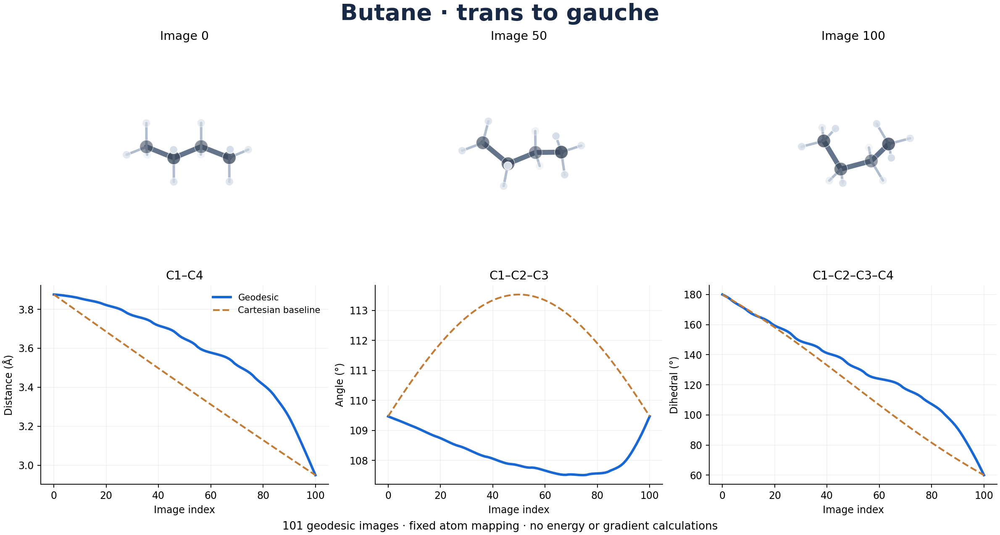

# Geodesic molecular paths in PySCF

Generate and inspect molecular interpolation paths, then track distances, angles
and dihedrals. Our main worked example is **butane, trans to gauche: 101 images,
14 mapped atoms and 65 coordinate traces, with no electronic energy or gradient
calculations**.

[](https://colab.research.google.com/github/Dilawars9/pyscf/blob/dilawar7/geodesic-interpolation/dilawar7/geodesic/notebooks/butane_path_explorer.ipynb)

[Butane guide](BUTANE.md) · [Notebook on GitHub](notebooks/butane_path_explorer.ipynb) ·
[HTML report](results/butane/report.html) · [Validation record](VALIDATION.md) ·
[Maintainer notes](../../MAINTAINER_NOTES.md)

## Try it in Colab

Open the notebook with the badge above, choose a normal CPU runtime, and select
**Runtime → Run all**. The notebook installs the scientific packages, loads our
feature modules from a pinned fork revision, generates the path, embeds the
interactive viewer, and demonstrates the measurement functions directly in
Python. A GPU and Google Drive mount are unnecessary.

Change the number of images, random seed or selected atom indices, then rerun
the relevant cells. The last cell prepares a ZIP with the report, XYZ paths,
CSV measurements, metadata and PNG/SVG figures. Set `DOWNLOAD_RESULTS = True`
in that cell to request the Colab download.

The notebook uses PySCF's prebuilt package for native libraries and loads only
our new Python feature modules. It does not compile the full fork. See the
[notebook notes](notebooks/README.md) for setup and validation scope.

## Explore the saved result

Download [report.html](results/butane/report.html) and open it in a WebGL-capable
browser. GitHub displays HTML source rather than running the viewer. The report
includes its data and viewer library, so a CDN or local server is unnecessary.

- Rotate the ball-and-stick molecule and play or scrub through all 101 images.
- Select a coordinate or pick atoms directly in the molecule.
- Follow synchronized distance, angle and unwrapped-dihedral plots.
- Compare the geodesic path with a Cartesian-interpolation baseline.
- Export the full path, one image or measurements, with a copyable-text fallback.



## Where the code lives

| Purpose | File |
| --- | --- |
| **Bond lengths / arbitrary pair distances, angles, dihedrals, torsion unwrapping and RMSD** | **[`pyscf/geomopt/path_analysis.py`](../../pyscf/geomopt/path_analysis.py)** |
| PySCF molecule-to-path adapter | [`pyscf/geomopt/geodesic.py`](../../pyscf/geomopt/geodesic.py) |
| Geometry-only butane generation and coordinate exports | [`examples/03_butane_path.py`](examples/03_butane_path.py) |
| Explicit atom-mapped endpoint construction | [`examples/butane_geometry.py`](examples/butane_geometry.py) |
| Interactive viewer and custom-coordinate calculations in the browser | [`report/report.js`](report/report.js) |
| Colab/Jupyter walkthrough | [`notebooks/butane_path_explorer.ipynb`](notebooks/butane_path_explorer.ipynb) |
| Measurement tests | [`test_path_analysis.py`](../../pyscf/geomopt/test/test_path_analysis.py) |
| Butane construction, exports and no-electronic-call checks | [`tests/test_butane_geometry.py`](tests/test_butane_geometry.py) |

With built, consistently atom-mapped `start` and `end` PySCF molecules:

```python
import numpy as np
from pyscf.geomopt.geodesic import interpolate
from pyscf.geomopt import path_analysis

images = interpolate(start, end, nimages=101)
xyz = np.asarray([mol.atom_coords(unit='Angstrom') for mol in images])

lengths = path_analysis.distances(xyz, [(0, 3)])       # Angstrom
angles = path_analysis.angles(xyz, [(0, 1, 2)])        # degrees
wrapped = path_analysis.dihedrals(xyz, [(0, 1, 2, 3)]) # signed degrees
torsions = path_analysis.unwrap_dihedrals(wrapped)
rmsd = path_analysis.aligned_rmsd(xyz)                 # Angstrom
```

The Python API uses **0-based indices**; viewer labels and CSV column names use
**1-based numbers**. Coordinates have shape `(nimages, natoms, 3)`; measurement
arrays have shape `(nimages, nselections)`. Undefined angles or torsions are NaN.
The API docstrings specify the signed-dihedral convention and degeneracy rules.

## Run locally

Use an environment containing this fork's Python modules and PySCF's native
libraries. A normal source installation of the full fork requires PySCF's build
dependencies; it has not been certified here. Colab's notebook setup uses the
wheel plus the two Python feature modules instead.

For the many-image example, install the tested sparse backend revision:

```sh
python -m pip install matplotlib 'geodesic-interpolate @ git+https://github.com/virtualzx-nad/geodesic-interpolate.git@476aa041f562d37d5fb4121b86817a52d75e4c5d'
OMP_NUM_THREADS=1 OPENBLAS_NUM_THREADS=1 python dilawar7/geodesic/examples/03_butane_path.py
```

Run these commands from the repository root. The published backend 1.0.0 uses
an older dense solver, so many-image runtime and memory consumption can differ.
[The butane guide](BUTANE.md) documents parameters, output files and conventions.

## Tests and scientific scope

The geometry-only checks are:

```sh
OMP_NUM_THREADS=1 OPENBLAS_NUM_THREADS=1 python -m pytest -q \
  pyscf/geomopt/test/test_path_analysis.py \
  dilawar7/geodesic/tests/test_butane_geometry.py
```

Nine focused tests passed for the original geometry-only explorer. Consult the
[validation record](VALIDATION.md) for notebook execution and browser checks,
including their limits.

Butane endpoints are idealized tetrahedral model geometries. The fixed bond
graph and atom correspondence are supplied explicitly. The interpolated path
is geometric; no energy-minimized path, physical time axis, optimizer
convergence certificate or validated reaction barrier is claimed.

## Earlier energy/gradient workflow examples

These small examples are retained separately and **do evaluate electronic
energies and gradients**:

- [Hydrogen exchange script](examples/01_hydrogen_exchange.py) and
  [saved results](results/hydrogen_exchange/).
- [Water bending script](examples/02_water_bending.py) and
  [saved results](results/water_bending/).

## Attribution

The interpolation algorithm is provided by
[geodesic-interpolate](https://github.com/virtualzx-nad/geodesic-interpolate).
This fork adds the PySCF adapter, geometry-analysis functions, examples and
viewer/report workflow. Molecular rendering uses [3Dmol.js](https://3dmol.org/),
with its license notices included in the report.

Developed with OpenAI Codex assistance for implementation, documentation and
testing. Any upstream contribution needs human review and must follow PySCF's
contribution and AI policies. Development branch: `dilawar7/geodesic-interpolation`.
